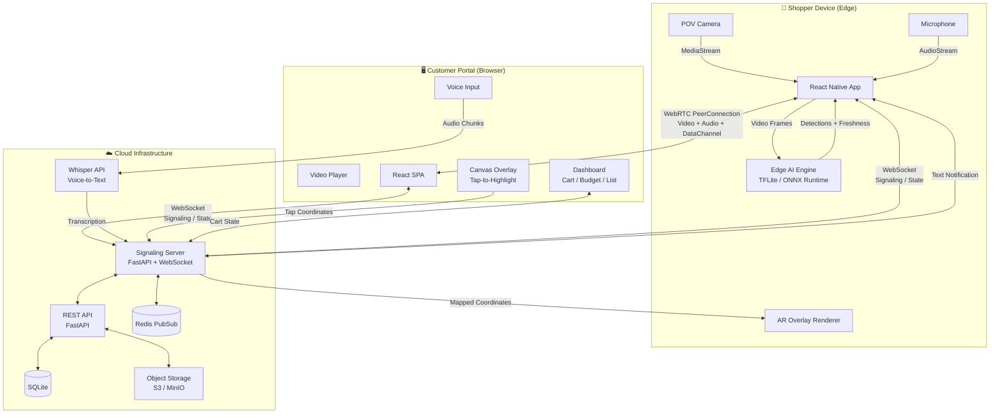
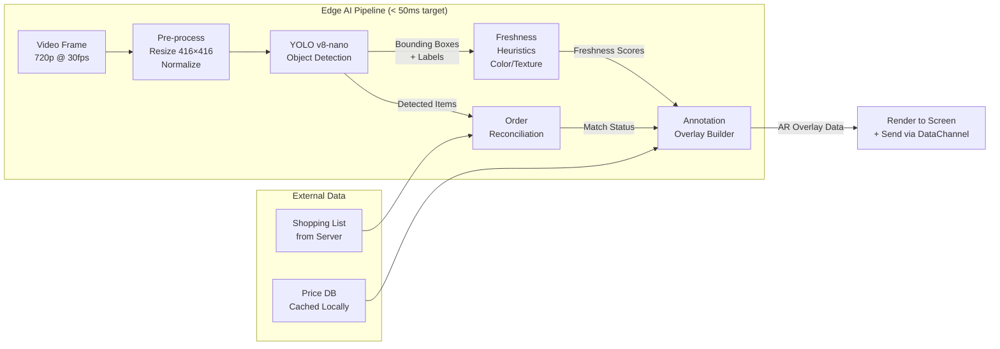
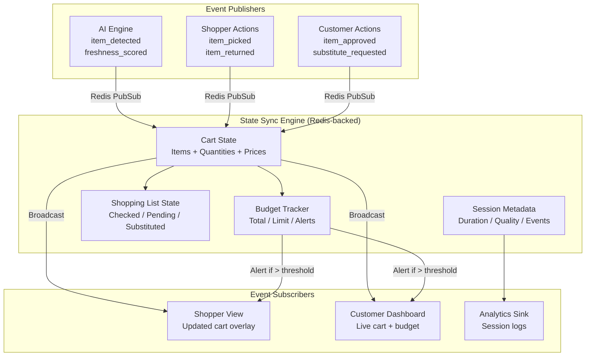
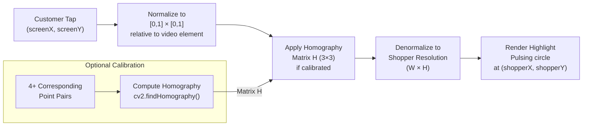
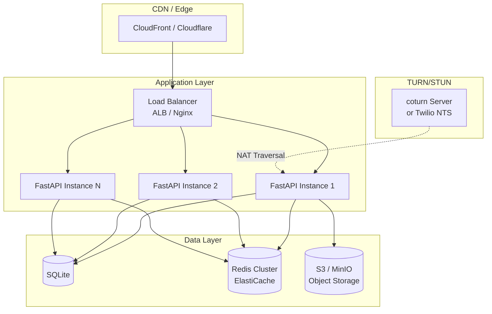

# VisionCart – System Architecture

## 1. High-Level Data Flow



## 2. WebRTC Connection Flow

```mermaid
sequenceDiagram
    participant S as Shopper App
    participant SIG as Signaling Server
    participant C as Customer Portal

    Note over S,C: Session Initialization
    C->>SIG: POST /api/sessions (create session)
    SIG-->>C: { session_id, signaling_room }
    C->>SIG: WS connect (session_id, role=customer)
    S->>SIG: WS connect (session_id, role=shopper)

    Note over S,C: ICE & SDP Exchange
    S->>SIG: { type: "offer", sdp: "..." }
    SIG->>C: Forward offer
    C->>SIG: { type: "answer", sdp: "..." }
    SIG->>S: Forward answer

    loop ICE Candidates
        S->>SIG: { type: "ice-candidate", candidate: "..." }
        SIG->>C: Forward candidate
        C->>SIG: { type: "ice-candidate", candidate: "..." }
        SIG->>S: Forward candidate
    end

    Note over S,C: Peer Connection Established
    S-->>C: Video + Audio (WebRTC)
    S<-->C: DataChannel (overlay coords, AI metadata)

    Note over S,C: Real-Time Interaction
    C->>SIG: { type: "tap", x: 0.45, y: 0.32 }
    SIG->>S: Forward tap coordinates
    S->>S: Render AR highlight at (0.45, 0.32)

    C->>SIG: { type: "voice", audio: <chunk> }
    SIG->>SIG: Whisper transcription
    SIG->>S: { type: "transcript", text: "Check the expiry date" }
```

## 3. AI/CV Processing Pipeline



## 4. State Synchronization Architecture



## 5. Coordinate Mapping System



## 6. Deployment Topology



## 7. Latency Budget

| Segment                        | Target   | Technique                          |
| ------------------------------ | -------- | ---------------------------------- |
| Camera → WebRTC encode         | < 15 ms  | Hardware H.264 encoder             |
| WebRTC transport (P2P)         | < 50 ms  | Direct peer, TURN fallback         |
| Signaling round-trip           | < 30 ms  | WebSocket, Redis PubSub            |
| Edge AI inference (YOLO-nano)  | < 25 ms  | TFLite GPU delegate, ONNX Runtime  |
| Freshness heuristic            | < 5 ms   | NumPy vectorized ops               |
| Canvas overlay render          | < 16 ms  | requestAnimationFrame, GPU canvas  |
| **End-to-end (video + overlay)** | **< 150 ms** | **Total latency budget**      |
