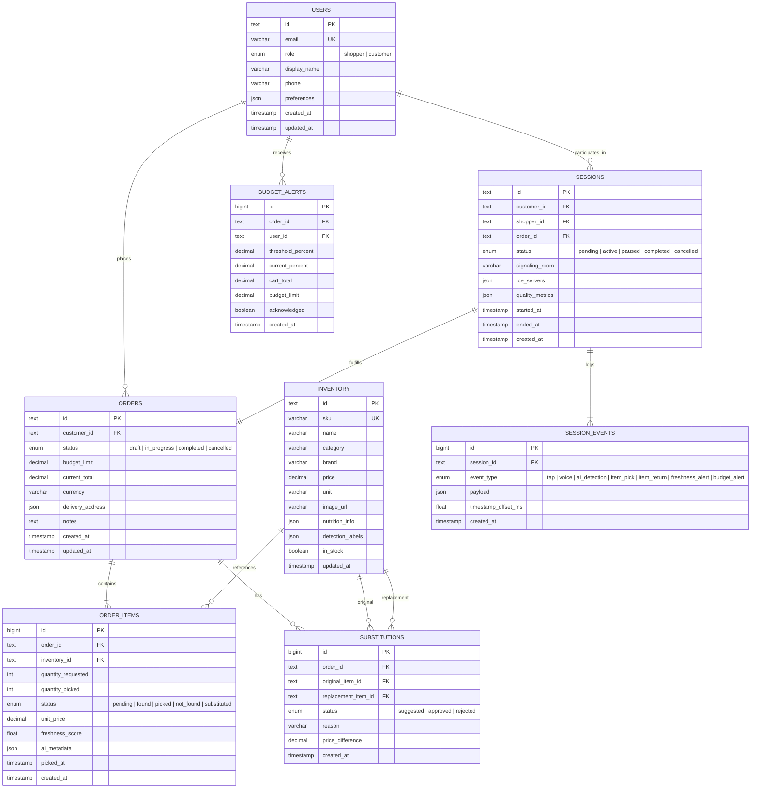

# VisionCart – Database Schema

## Entity-Relationship Diagram



## Table Details

### `users`
Primary identity table. Supports both `shopper` and `customer` roles. The `preferences` JSON column stores notification settings, default budget, preferred stores, etc.

### `sessions`
Represents a live shopping session. Links one customer to one shopper with a specific order. The `signaling_room` is the WebSocket room ID for SDP/ICE exchange. `quality_metrics` tracks bitrate, frame drops, and latency samples.

### `session_events`
Append-only event log for each session. `timestamp_offset_ms` is relative to `session.started_at` for replay synchronization. The `payload` JSON varies by `event_type`:

- **tap**: `{ "x": 0.45, "y": 0.32, "radius": 30 }`
- **voice**: `{ "transcript": "Check the expiry", "confidence": 0.94 }`
- **ai_detection**: `{ "label": "banana", "confidence": 0.87, "bbox": [x,y,w,h], "freshness": 0.72 }`
- **item_pick**: `{ "order_item_id": "...", "inventory_id": "..." }`
- **budget_alert**: `{ "percent": 92, "total": 46.50, "limit": 50.00 }`

### `orders`
Shopping order with budget tracking. `current_total` is denormalized and updated via triggers/application logic on every item pick.

### `order_items`
Line items linking an order to inventory. `ai_metadata` stores the last detection context (bounding box, freshness breakdown, image snapshot URL).

### `inventory`
Store product catalog. `detection_labels` maps CV model class names to this product (e.g., `["banana", "cavendish_banana"]`). Updated via store API integration or manual import.

### `substitutions`
Tracks when the AI or shopper suggests a replacement for an unavailable/poor-quality item.

### `budget_alerts`
Persisted alerts for audit. Created when `current_total / budget_limit` exceeds the configured threshold.

## Indexes

```sql
-- Performance-critical queries
CREATE INDEX idx_sessions_status ON sessions(status);
CREATE INDEX idx_sessions_customer ON sessions(customer_id);
CREATE INDEX idx_sessions_shopper ON sessions(shopper_id);
CREATE INDEX idx_order_items_order ON order_items(order_id);
CREATE INDEX idx_order_items_status ON order_items(order_id, status);
CREATE INDEX idx_session_events_session ON session_events(session_id, created_at);
CREATE INDEX idx_session_events_type ON session_events(session_id, event_type);
CREATE INDEX idx_inventory_sku ON inventory(sku);
CREATE INDEX idx_inventory_category ON inventory(category);
```
